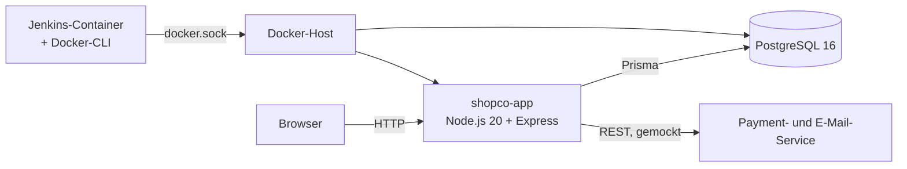
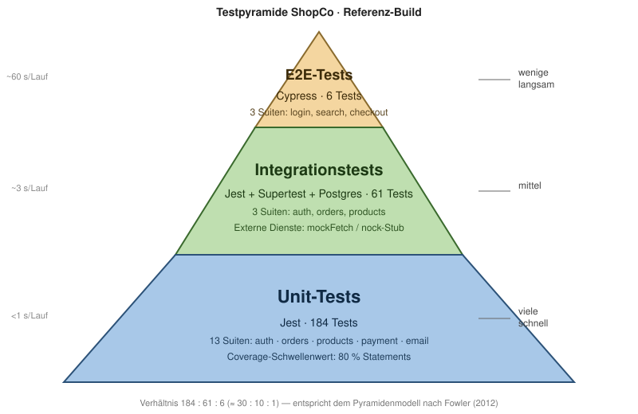

# ShopCo – CI/CD-Fallstudie

Jenkins-Pipeline mit Build, Tests und Deploy-Stufen für ein E-Commerce-Backend. Die Anwendung, die Testumgebung und Jenkins laufen komplett in Docker.

## Überblick

ShopCo ist ein REST-Backend für einen kleinen Onlineshop (Produkte, Warenkorb, Bestellungen, Login). Der Schwerpunkt der Fallstudie liegt nicht auf der Anwendung selbst, sondern auf der Qualitätssicherung und Auslieferung:

- **Jenkins-Pipeline** mit fünf Stufen: Build, Unit- und Integrationstests, E2E-Tests, Staging-Deploy und manuelle Freigabe für Produktion
- **Docker**: Multi-Stage-Image für die Anwendung, Docker Compose für Datenbank und Testumgebung, eigener Jenkins-Container mit Docker-CLI
- **Testpyramide**: Unit- und Integrationstests mit Jest, E2E-Tests mit Cypress, Mindest-Coverage von 80 %

## Architektur



Das ausführliche Diagramm liegt in [`architektur.mmd`](architektur.mmd).

## Pipeline

Die Pipeline ist im [`Jenkinsfile`](Jenkinsfile) definiert und prüft das Repository alle 5 Minuten auf Änderungen.

| Stufe | Was passiert |
| --- | --- |
| 1. Build | `npm ci` und `prisma generate` |
| 2. Unit- und Integrationstests | Startet eine Test-Datenbank per Docker Compose, spielt die Migrationen ein und führt Jest mit Coverage aus. JUnit-Report und Coverage-Report werden in Jenkins veröffentlicht. |
| 3. E2E-Tests | Baut das App-Image, startet App, Datenbank und Cypress als Container und führt die Browser-Tests aus. Screenshots und Videos werden archiviert. |
| 4. Deploy Staging | Nur auf `main`: baut das Image über [`scripts/deploy.sh`](scripts/deploy.sh) |
| 5. Manuelle Freigabe | Nur auf `main`: wartet auf Bestätigung, bevor in Produktion ausgeliefert wird |

**Hinweis:** Die Deploy-Stufen sind simuliert. Es gibt keinen echten Staging- oder Produktionsserver. `deploy.sh` baut das Image, Push in eine Registry und `kubectl apply` sind als Platzhalter vorbereitet.

Nach jedem Lauf werden alle Test-Container und Volumes wieder entfernt.

## Tests



| Ebene | Werkzeug | Umfang |
| --- | --- | --- |
| Unit-Tests | Jest | Services für Auth, Warenkorb, Bestellungen, Rabatte, Steuern, Versand, Lager, Zahlung, E-Mail und Produktsuche |
| Integrationstests | Jest + Supertest gegen echte PostgreSQL | API-Endpunkte für Auth, Produkte und Bestellungen |
| E2E-Tests | Cypress | Login, Produktsuche und kompletter Checkout im Browser |

Externe Dienste (Payment, E-Mail) werden in Unit-Tests mit einem Fetch-Mock und in Cypress mit `cy.intercept` ersetzt. Die Coverage-Schwelle liegt bei 80 % der Statements, darunter schlägt der Build fehl.

## Lokal starten

Voraussetzungen: Docker und Node.js 20.

```bash
# Datenbank starten
docker compose up -d db

# Abhängigkeiten installieren, Datenbank vorbereiten
cp .env.example .env   # DATABASE_URL auf localhost:5433 anpassen
npm ci
npm run prisma:migrate
npm run prisma:seed

# Anwendung starten (http://localhost:3000)
npm run dev
```

### Tests ausführen

```bash
# Test-Datenbank starten
docker compose -f docker-compose.test.yml up -d db-test

npm run test:unit
npm run test:integration
npm run test:coverage

# E2E-Tests komplett in Containern
docker compose -f docker-compose.test.yml --profile e2e up -d --wait --build
docker compose -f docker-compose.test.yml --profile e2e run --rm cypress cypress run
```

### Jenkins starten

```bash
docker build -f Dockerfile.jenkins -t my-jenkins .
docker run -d --name jenkins -p 8080:8080 \
  -v jenkins_home:/var/jenkins_home \
  -v /var/run/docker.sock:/var/run/docker.sock \
  my-jenkins
```

Danach in Jenkins unter http://localhost:8080 einen Pipeline-Job anlegen, der das `Jenkinsfile` aus diesem Repository verwendet.

## API

| Methode | Pfad | Auth |
| --- | --- | --- |
| `GET` | `/api/health` | – |
| `POST` | `/api/auth/register`, `/login`, `/forgot-password`, `/reset-password` | – |
| `GET` | `/api/auth/me` | JWT |
| `GET` | `/api/products`, `/api/products/categories`, `/api/products/:id` | – |
| `GET`, `POST`, `DELETE` | `/api/orders/cart`, `/api/orders/cart/items` | JWT |
| `POST` | `/api/orders/checkout` | JWT |
| `GET` | `/api/orders`, `/api/orders/:id` | JWT |

## Tech-Stack

Node.js 20, Express, PostgreSQL 16, Prisma, JWT, Jest, Supertest, Cypress, Docker, Docker Compose, Jenkins
